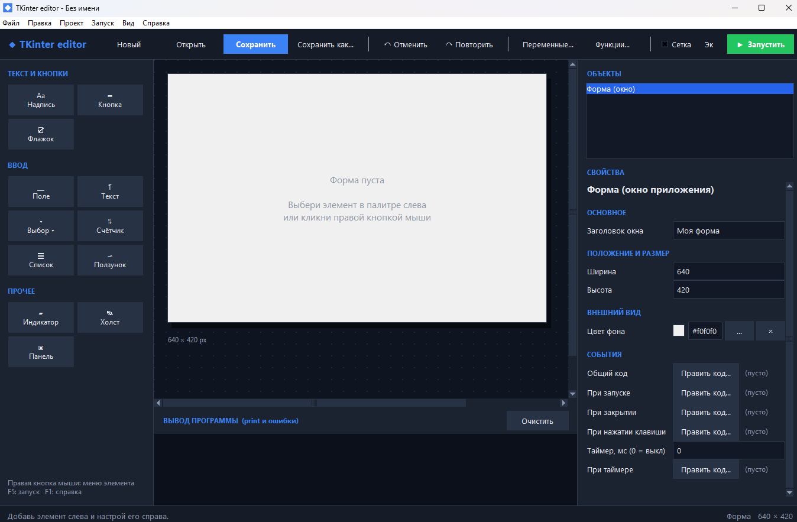

# TKinter editor

**Визуальный редактор форм для tkinter**: перетаскиваешь элементы мышью, настраиваешь свойства в инспекторе,
пишешь код событий на Python, запускаешь форму прямо в редакторе и экспортируешь готовый скрипт.
Один файл, без внешних зависимостей (только стандартная библиотека Python).

> *English:* TKinter editor is a single-file visual form designer for Python's tkinter (drag & drop widgets,
> property inspector, variables, custom functions, event code, live preview, export to a standalone `.py` script).
> The interface is in Russian.

<!-- Положи скриншот в docs/screenshot.png и раскомментируй строку ниже

-->

## Возможности

- **12 элементов**: надпись, кнопка, флажок, поле ввода, многострочный текст, выпадающий список, счётчик,
  список, ползунок, индикатор, холст, панель. Двигаются и растягиваются мышью, привязка к сетке.
- **Инспектор свойств**: имя, положение и размер, текст, цвета, шрифт, рамка; свойства формы (заголовок, размер, фон).
- **Переменные** (число, дробное, текст, да/нет, список): в коде как обычные имена, в тексте надписей и кнопок
  как `{имя}`: значение подставляется само.
- **Свои функции** с параметрами и `return`: вызываются из любых событий и друг из друга.
- **События с кодом на Python**: нажатие, клик, двойной клик, курсор над элементом, Enter, изменение текста,
  выбор в списке, ползунок, таймер, при запуске / закрытии / нажатии клавиши формы (переменная `event`).
- **Общий код формы**: импорты и свои вспомогательные функции.
- **Редактор кода**: подсветка, автоотступ, проверка синтаксиса, шаблоны, список элементов, переменных и функций.
- **Запуск формы** (F5) с панелью вывода (`print` и ошибки), **сохранение / открытие** проектов `.tkform` (JSON),
  **экспорт в самостоятельный `.py`**.
- Тёмная и светлая темы, меню, контекстное меню (правая кнопка мыши), отмена и повтор, недавние проекты.

## Установка и запуск

Нужен Python 3.8+ (tkinter входит в установщик с [python.org](https://www.python.org/downloads/)).

```bash
git clone https://github.com/<ваш-аккаунт>/TKinter-editor.git
cd TKinter-editor
python tkinter_editor.py
# или сразу с проектом:
python tkinter_editor.py examples/widgets_demo.tkform
```

Основная платформа: **Windows**. На Linux и macOS программа не проверялась: возможны мелочи
(например, форма курсора на маркерах или прокрутка колесом).

## Быстрый старт

1. Нажми элемент в палитре слева (или правой кнопкой по форме: «Добавить сюда»).
2. Двигай его мышью, свойства меняй справа в инспекторе.
3. У кнопки открой «При нажатии» > «Править код…» и напиши, например:
   ```python
   clicks += 1
   set_text("result", "Привет, " + get_text("entry1") + "!")
   ```
4. Переменные создаются кнопкой «Переменные…», в тексте надписи пиши `Нажатий: {clicks}`.
5. **F5**: запуск формы. **Экспорт .py**: готовый скрипт.

Примеры лежат в папке [`examples`](examples): `example.tkform` и `widgets_demo.tkform` (все элементы, функции, холст).

## Что доступно в коде событий

| Функция | Что делает |
|---|---|
| `get_text("имя")`, `get_value("имя")`, `get_num("имя")` | значение элемента (текст / число) |
| `set_text("имя", ...)`, `set_value("имя", ...)` | изменить текст / значение (ползунок, индикатор, флажок) |
| `set_prop("имя", bg="red")` | изменить любые свойства виджета |
| `show`, `hide`, `enable`, `disable`, `move` | показать, спрятать, блокировать, переместить |
| `get_items`, `set_items`, `add_item`, `get_selected` | работа со списками |
| `msg`, `ask_yes_no`, `ask_string`, `ask_number` | окна сообщений и ввода |
| `open_file_dialog`, `save_file_dialog`, `read_file`, `write_file` | файлы |
| `after(мс, функция)`, `now("%H:%M")`, `beep()` | время и звук |
| `copy_to_clipboard`, `open_url`, `quit_app` | буфер обмена, браузер, закрыть окно |
| `w["имя"]`, `root`, `event` | сам виджет tkinter, окно, событие мыши / клавиатуры |

Полный список с описанием: меню **Справка** (F1).

## Сборка в exe (Windows)

```bash
pip install pyinstaller
pyinstaller --onefile --noconsole --name "TKinter editor" tkinter_editor.py
```

## Формат проекта

`.tkform` это обычный JSON: `form`, `variables`, `functions`, `items`. Его можно править руками, файлы старых
версий открываются автоматически.

## Ограничения

- Вложенных контейнеров нет: элементы лежат прямо на форме, расположение абсолютное (`place`).
- Запуск из редактора выполняет код в процессе редактора: бесконечный цикл `while True` в событии повесит
  и форму, и редактор (для повторов используй таймер или `after`).

## Лицензия

[MIT](LICENSE)
